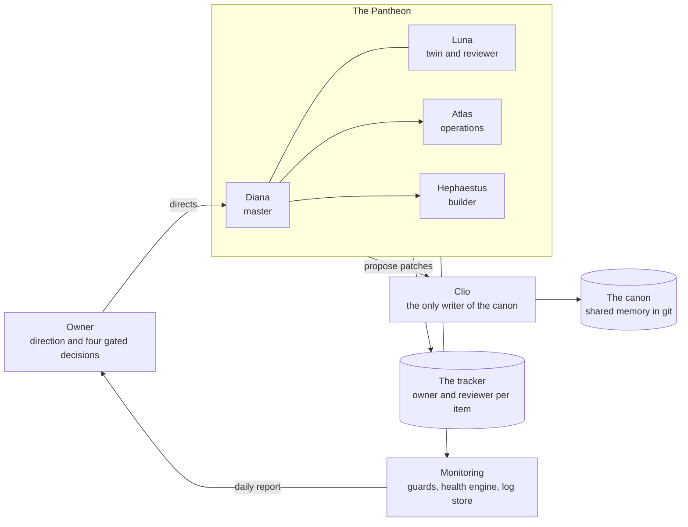

# Olympus and the Pantheon

A home lab run by a small team of AI agents, described in the open.

Olympus is the name of the whole landscape: a NAS, a hypervisor with a few virtual machines, a rented server, a firewall, a mesh of VPN links and a spare PC that serves a local language model. The Pantheon is the team of AI agents that live on it. They watch it, repair it, extend it and report on it. One human, the owner (Prometheus, also known as Macel), sets the direction and keeps the final say over a short list of decisions.

This repository explains how that works: who the agents are, how they agree on what is true, how they review each other, what they build, what they have got wrong and which rules came out of it. It is written for people who want to run something similar, and for anyone curious what a multi-agent operation looks like after months of real use, failures included.

> [!NOTE]
> Everything here is public by design. The repository contains no credentials, addresses, host names or personal records. Numbers are aggregate counts. Where something does not exist or does not work, the text says so.

## The system in one picture

## At a glance

| Topic | In short |
|---|---|
| Agents | Four working agents (Diana, Luna, Atlas, Hephaestus) and one write-gate script (Clio). An independent checker on a different model family belongs to the design and is currently switched off. |
| Owner | One human who sets direction and approves four classes of decision. |
| Shared memory | A git repository, the canon, with exactly one writer. |
| Personal memory | Each agent keeps its own, next to the shared one, plus a written handover for every restart. |
| Work tracking | A tracker in which every item has an owner and a different reviewer. |
| Messaging | Plain files in lanes on the NAS. A service was deliberately not chosen. |
| Monitoring | About a hundred monitors, per-seat guards, a health engine, and a log store for network events with a daily report-only audit. |
| Budget | One shared subscription pot, a gate by kind of work, and a scheduler that turns idle quota into work. |
| Safety | A command filter in front of every shell, the single-writer rule, four-eyes review, and a short list of decisions only the owner takes. |
| Public project | Aion, an evidence-graded atlas of history: [the globe](https://aion.eanna.house/site/) and [its GitHub page](https://github.com/Mbrilman/aion-time-globe). |

## Where to start

| If you want to know | Read |
|---|---|
| How the machines fit together | [Architecture](docs/architecture.md) |
| Who does what and why the roles are split | [Agents](docs/agents.md) |
| How the agents keep each other honest | [Method](docs/method.md), [The dream and the review systems](docs/dream-and-review.md) |
| What is built and running | [Projects](docs/projects.md), [Monitoring and the log store](docs/monitoring-and-logs.md), [Home automation](docs/home-automation.md) |
| How memory, context and restarts work | [Memory and context](docs/memory-and-context.md) |
| How budget and credentials are handled | [Quota and tokens](docs/quota-and-tokens.md) |
| How the owner is kept informed | [Reporting and channels](docs/reporting-and-channels.md) |
| Where it is going | [Plans and ideas](docs/plans.md) |
| What went wrong | [Lessons learned](docs/lessons-learned.md) |
| What is public, private and off limits | [Safety and privacy](docs/safety-and-privacy.md) |
| What it builds on | [References](docs/references.md) |

The family and its members: [members/family.md](members/family.md). A project page: [Client certificates](docs/certificates.md).

## What this is not

It is not a product or a framework you can install; the tools are specific to one household and one set of machines. It is not a claim that agents can run unattended without a human. The owner stays in the loop for money, for exposure to the outside world, for actions that cannot be undone and for anything only a person can do physically, and the agents' job is to keep that list short and never let it grow by accident. And it is not finished: several items in the lessons file are still open at the time of writing.

## The method in one paragraph

The agents share one memory, a git repository that a single script may write to, so no agent can quietly rewrite what the others rely on. Every change has an owner and a different agent as reviewer, and a review means measuring again: the reviewer re-runs the tests and re-checks the sources instead of trusting the report. Tools are tested with tests that were first shown to fail, so a green result means something. Monitoring is judged from outside the thing being monitored, and "I could not measure this" is an answer that is never allowed to look like "all is well". The agents report to the owner once a day by mail and decide everything else themselves, unless it falls into the four gated classes.

## Samenvatting in het Nederlands

Olympus is een thuisnetwerk met een NAS, virtuele machines, een gehuurde server en een firewall. De Pantheon is het team van AI-agents dat dit beheert, bewaakt en verder bouwt. Ze delen één geheugen, een git-repository waar maar één script in mag schrijven. Elk werkstuk heeft een eigenaar en een controleur, en controleren betekent opnieuw meten. De mens bepaalt de richting en beslist alleen over geld, blootstelling naar buiten, onomkeerbare acties en wat alleen hij fysiek kan. Alles hier staat openbaar, zonder wachtwoorden, adressen of persoonlijke gegevens.
