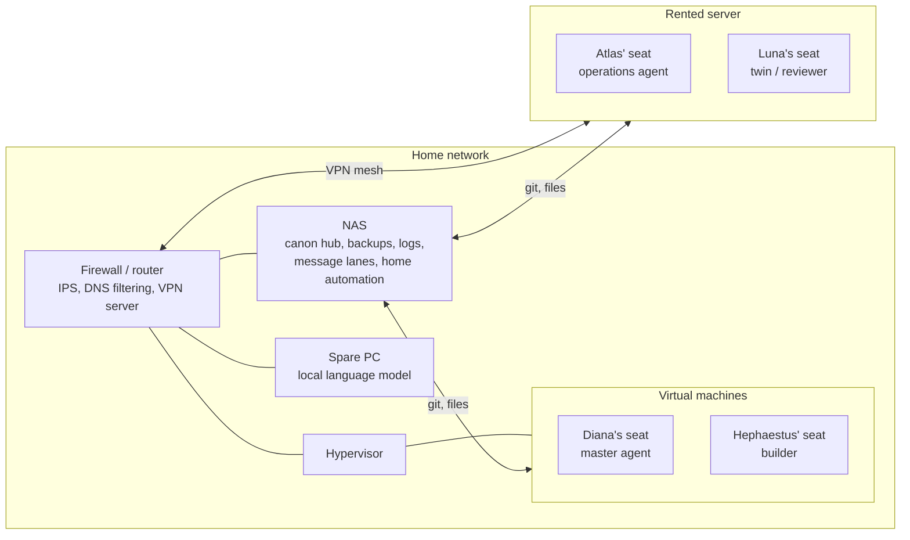

# Architecture

This page describes the machines by role. It deliberately contains no addresses, host names or account names.

## The landscape

## The pieces

**The NAS is the foundation.** It holds the git hub of the canon (the shared memory), the daily snapshots, the message lanes, the security log store, the monitoring database and the home-automation system. It is only reachable from inside the network. Everything that must survive an outage of any other machine lives there or is mirrored there.

**The hypervisor hosts virtual machines**: the master agent's seat and the builder's seat (a guest for the independent checker exists but is not in service). Putting them on one physical host is a known shared-fate risk, and the monitoring is built to detect it rather than assume it away.

**The rented server hosts two seats**: the operations agent's and the twin's, each under its own unix user with its own terminal multiplexer and sockets. Because two agents share one host, a statement like "the host is healthy" is meaningless here. Every statement names the seat. A table keyed by host once read as complete because one seat had filled the row while the other had no row at all. The register is therefore keyed by agent and host, never by host alone.

**The firewall is the only router.** It does IPS, DNS filtering and the VPN server. Changes to it are one of the things the owner approves (with a short list of pre-agreed routine exceptions such as DNS and DHCP entries).

**A spare PC serves a local language model.** It is used for light language work (summaries, classification, drafting) and as a second, cheaper reader for verification work. It is often switched off and is brought up on request, and its health check does a real completion, so a green status means the model answered, not that a port was open. It is a second shared-fate edge: its power state decides whether the fleet's cheap reader exists at all. It is not a source of truth: its output is information, never an order (see Law 9 in the [method](method.md) page).

**The network is segmented**: a general segment, an IoT segment and a camera segment, each with fixed addressing and its own rules.

## Seats, not hosts

The unit that matters is the **seat**: one agent running under one unix user on one host. Liveness, versions, cron lines and guard results are all recorded per seat. The vocabulary was learned the hard way: whenever "the host" was used in a sentence about the rented server, the sentence was wrong for one of its two seats.

## What talks to what

- Agents read and propose through git, with one gated writer ([method](method.md#the-canon-and-the-one-pen)).
- Agents talk to each other through files in lanes on the NAS ([reporting and channels](reporting-and-channels.md#iris-the-message-lanes)).
- Guards on every seat report liveness to a monitoring system that does not depend on the seat's own opinion of itself ([projects](projects.md#monitoring)).
- A health engine reads an expected set and judges each seat from a vantage point other than its own ([projects](projects.md#panoptes-the-health-engine)).

## Design principles that shaped this layout

1. **Boring, inspectable storage.** Messages are files. A human can read a lane during an incident with `ls` and `cat`.
2. **No single point of memory.** Every seat holds a clone of the canon; the NAS adds a mirror, snapshots and a weekly off-site copy. A restore has been performed, not just written down.
3. **Independence for checks.** A check that shares fate with what it checks verifies nothing. The independent checker, when it is in service, runs on a different model family and has no write access to the canon. It is switched off at the moment of writing.
4. **Names carry function.** Machines and components take names from Greek and Roman myth, one deity per role, so a name in a log tells you what kind of thing you are looking at.
