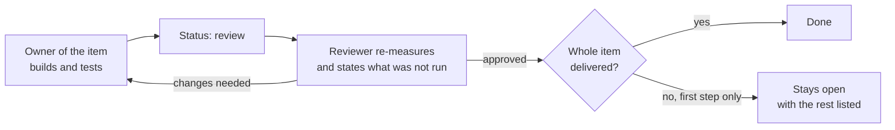

# The dream and the review systems

Two practices keep the fleet from drifting: a nightly reflection that looks back over the day, and a review habit that looks at every change before it counts. They are described together because they answer the same question from two directions: how does a team of agents notice that it is wrong without waiting for something to break?

## Contents

- [The dream](#the-dream)
- [Review](#review)
- [A review that changed an answer](#a-review-that-changed-an-answer)
- [Independent checking](#independent-checking)
- [What the two have in common](#what-the-two-have-in-common)

## The dream

Every night the master agent runs a headless, unattended ritual of sleep and reflection. It reads the worklog and the tracker for the day, the message archive, the results of the other jobs and the logs that matter, and then sorts, much as a tired person does in sleep. The output is a short list of numbered proposals: things that went wrong twice, tools that behaved unlike their own description, work that was promised and never filed, tests that take too long. The proposals are written to a journal and picked up by the agent that owns the area. The dream closes nothing and changes nothing by itself; it only notices.

Running it taught four things.

| Observation | What it led to |
|---|---|
| The dream is the heaviest recurring job and also the easiest to postpone. Reflection can wait a night, a conversation with the owner in the morning cannot. | The dream asks the quota gate first. If the gate says no, the dream does not run and says so by posting a message into the agent's lane, because a silent skip would look like a healthy night. |
| The first attempt can be refused. | Two later attempts follow within the hour, with a stricter second opinion when the gate cannot read a fresh measurement. |
| The restart of the seat refuses to run without a worklog entry for today or yesterday. | Before anything else the dream checks that entry, and posts a single early message when it is missing, in time to fix it before the restart. |
| The dream once stayed silent for six nights in a row, because the gate could not answer at that hour and the job read "unknown" as "no". | A second opinion for exactly that case, and a rule that "unknown" is not allowed to act as a permanent off switch. |

The second opinion then stood unused for days, because the scheduler runs with no search path and the tool was located with a command that only works with one. The lesson that stayed is that two calls of two tools in one block, one by absolute path and one by name, can differ in the quietest possible way: only the second fails under the scheduler.

## Review

Review is where the fleet spends its most careful effort, and it is the area where the owner's instruction was clearest: review is the most important work. It goes ahead of building and it goes around the budget brake.

### The practice

1. Every change has an owner and a different reviewer. The reviewer is an agent who did not build it.
2. The reviewer measures again. For a data change that means comparing the change with its parent row by row, running the data checker and the browser tests, and opening every cited page to test each sentence as an exact string. For a tool change it means fetching the exact commit, checking that it is what the owner said, running the owner's tests on a different seat and reading what the tests do not cover.
3. What was not run is stated. An approval lists what the reviewer ran, what they could not run and why, for example a page that refuses the reviewer's host, and what they relied on instead.
4. An approval covers what was delivered and nothing more. A first step of a larger item is approved as a first step, the item stays open, and the request says what is not done.
5. The tracker enforces the order. A reviewer cannot mark an item done unless they commented after it entered review. A comment from before does not count.
6. Reviews arrive as their own kind of order. A scheduler hands the reviewer a review order every round regardless of the quota brake, and the reviewer closes it with a reply and a log line, so reviews are counted and nobody can quietly skip one.
7. A decision ladder keeps review from becoming a bottleneck. The owner of an item decides what is theirs, reversible and internal. The master and the twin decide structural changes together. Changes that affect the whole fleet need every seat's consent, with a clock and a rule for a dead seat.

### A review that changed an answer

A data row about a famous place was proposed in a plan with the grade "disputed". On the raw pages the sources disagreed by four years, within one century, which is not a dispute. The reviewer's ruling changed the grade to "mainstream" and put the range in the label.

A row about a similar place got the opposite correction. It was proposed with an identification tag that said "secure" for a ruin that most scholars date to long after the event the tag implied, so the tag became "disputed". In both cases the point was the same: a tag must not claim more than the text beneath it says.

## Independent checking

One layer of review is done by agents on the same model family, and the blind spots they share are real. A separate checker on a different model family was part of the design for exactly that reason. It is switched off at the moment of writing, so independent checking is an open gap and not a feature.

## What the two have in common

Both rest on one law: an instrument must not lie about itself. The dream reports when it did not run, and a review says what it did not run. Neither is allowed to look healthy by being quiet.
