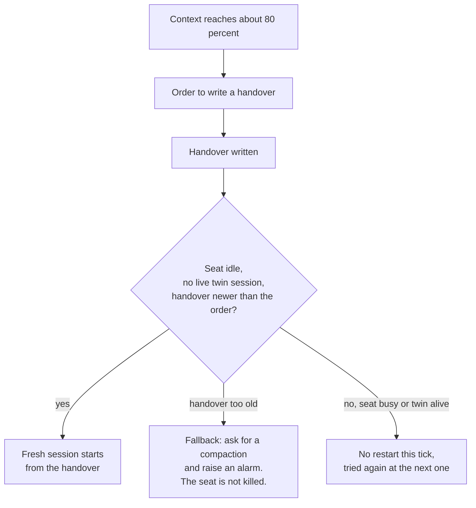

# Memory and context

An agent is a long-running session with a finite context window. What matters has to survive three things: the window filling up, a restart, and the agent being replaced by a fresh one that knows nothing. The fleet's answer is several layers of memory with different owners and different rules.

## Contents

- [The layers](#the-layers)
- [Personal memory](#personal-memory)
- [The handover](#the-handover)
- [The restart](#the-restart)
- [Search over preload](#search-over-preload)
- [Promises become items](#promises-become-items)

## The layers

| Layer | Owned by | Holds | Written by |
|---|---|---|---|
| The canon | Everyone, read-only | Shared books, laws, tools, the register and the worklog | One script (Clio) |
| The tracker | Everyone | Every piece of work with its owner, reviewer and the trail of what was measured and decided | The owner and reviewer of an item, through one client |
| The message lanes | One lane per agent | What is waiting for that agent right now | Anyone, by writing a message file |
| Personal memory | Each agent for itself | What the agent has learned about working with the owner and the fleet: preferences, corrections, confirmed approaches, pointers | Only that agent, locally |
| The handover | The seat that writes it | The working state that exists nowhere else: what was in progress, what was promised and the exact next step | The outgoing session |

Each agent therefore has a memory of its own next to the shared one, and both exist on purpose. The relevant law is short: personal flows go up only where the design routes them up, and a personal working-memory handoff is deliberately local and not part of the canon.

## Personal memory

Each agent keeps a small private memory made of an index with one line per memory and one file per fact. A file has a type, a one-line description that decides whether it is relevant, and a body in a fixed shape: the rule, why it exists (usually the incident or instruction that produced it), and how to apply it. Four types are used: facts about the owner, feedback in the form of corrections and confirmed approaches, project context that cannot be derived from the code, and references to where something lives.

Four rules keep it honest.

1. The memory does not duplicate the canon. Code structure, history and tool behaviour live in the repository, and a memory is for what cannot be derived from it.
2. A memory is a claim about a past moment. Before an agent acts on one that names a file, a flag or a host, it checks that the thing still exists. A periodic sweep verifies a few memories against the live state; the latest one confirmed four of four and found three index lines that had lost a word of scope, which were restored.
3. A memory never overrides the instructions of the day. A recalled memory is background and not an order.
4. A wrong memory is deleted, not argued with. One memory exists because an agent once wrote down a state of the world as a fact without measuring it, and the rule that came out of it is to measure before writing a state down.

## The handover

The handover process is called Lethe, after the river of forgetting, because its whole purpose is that nothing important is forgotten across a restart. When an agent's context reaches about 80 percent, the agent is told to write a handover. The handover is deliberately short and always has the same five parts.

| Part | Content |
|---|---|
| The next step | Written so that it can be carried out without questions: do this first |
| Where I was | The one thing that was in the middle of happening and exists nowhere else |
| Instruments that lied today | Tools that did something other than their own text said, written down when they were found |
| The hard state | The canon head, the last worklog entry, quota, open mail per lane and the session identity |
| What the new session does | In order, ending with the instruction to carry out the next step and not to recite a status list |

A new session reads the handover as a starting point and not as an order. The handover states how old it is and how many restarts have happened since it was written, because the next step may already be done. The new session therefore checks the tracker, the logs and the schedule first and acts afterwards.

## The restart

A restart tool starts a fresh session from the handover when the agent is idle. It runs on a fixed schedule instead of reacting to a panic, and it has guards.

The tool does not restart a seat in the middle of a turn. It does not restart a seat while a twin session of the same seat is alive; allowing one known interactive twin is designed and not yet in service. And it requires a handover that is newer than the trigger. A handover written before the order does not count: the agent has to write it again, and if it does not, the tool asks for a compaction and raises an alarm without killing the seat. That case was found in real use and is on record.

Automatic compaction, in which the tool summarises the context itself, is switched off by decision on the seats where the handover process is proven. A seat where it is not yet proven may run with compaction on until it is. The reasoning is that a summariser decides what to forget without anybody having chosen it, while a handover is written by the one who knows what matters. The consequence is accepted: an agent can be quiet for a short while around a restart, and the cost of a bad restart is visible, whereas the cost of a bad summary is not.

## Search over preload

The agents are told to search instead of preloading. A long preloaded context makes every turn slower and more expensive and buries what matters, so the canon, the tracker and the message archive are searched when they are needed. For the same reason a handover drops tool output, file contents, canon text that is already in the repository and the wording of the conversation, and keeps only item identifiers with their status, open questions, the current task with its next step, and every promise made in chat that is not yet an item.

## Promises become items

A promise made in conversation is a debt. The rule came out of repeated loss: "that will become an item" is turned into an item in the same turn, with an owner and a reviewer. At the end of every work block the agent reads back its own output of the session, marks every promise ("I will file", "later", "not measured") and counts three numbers: promises found, items filed and the difference between them. The work is done when the difference is zero.
