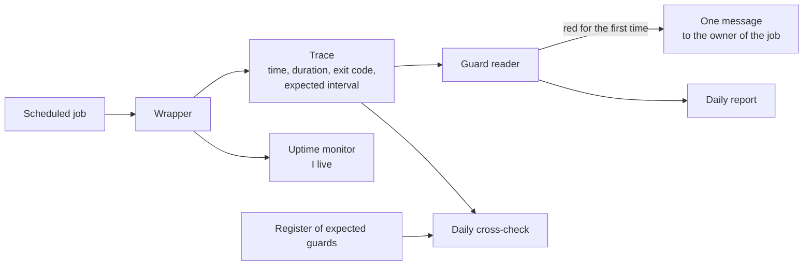
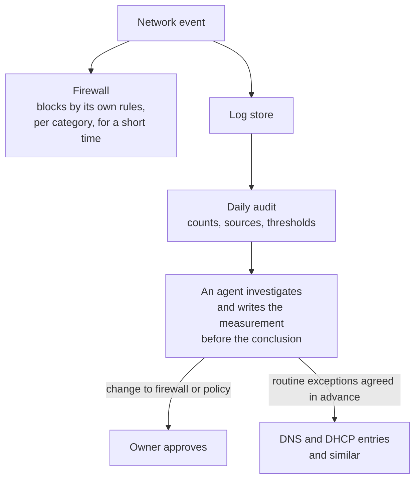

# Monitoring and the log store

This page follows one idea from the sensor to the person who reads the result: who notices, who is told, who acts, and how we know that the noticing itself still works.

## Contents

- [The layers](#the-layers)
- [Guards](#guards)
- [Alarm routing](#alarm-routing)
- [The log store and the network](#the-log-store-and-the-network)
- [From a notification to a reaction](#from-a-notification-to-a-reaction)
- [Updates](#updates)
- [The freeze switch](#the-freeze-switch)
- [When we cannot measure](#when-we-cannot-measure)
- [Known weak points](#known-weak-points)

## The layers

| Layer | What it watches | Who reads it |
|---|---|---|
| Uptime monitoring | About a hundred monitors in a self-hosted Uptime Kuma: HTTP and keyword checks, pings, group monitors, and push monitors that turn red when a scheduled job stops checking in | Agents, and the owner through notifications |
| Guards | Every recurring job on every seat, wrapped so that it leaves a trace with time, duration, exit code, expected interval and a verdict | A guard reader on each seat, and a daily cross-check against a register of what should exist |
| Health engine (Panoptes) | The whole fleet, from a vantage point other than the seat being judged | The agents, through a status page and a short per-agent list |
| Log store | Events from the network devices: firewall, intrusion prevention, DNS filter, access points and switches | A daily report-only security audit, and any agent that investigates |

## Guards

A recurring job runs inside a small wrapper. The wrapper records a trace of the run, writes it locally and to the shared NAS where every agent can read it, and sends an "I live" signal to the uptime monitor for the human side.

Three rules came out of use.

1. The exit code is the verdict. Success is never inferred from the fact that the command did not crash.
2. A trace without an expected interval is only a timestamp. The interval is mandatory, so "silent for three days" is a fact that can be computed.
3. A red guard becomes exactly one message to its owner. The message does not repeat while the same episode lasts, and it is posted again only after the guard has been green and then red once more.

A guard that is red but has not woken its owner still appears in the daily report. That is deliberate: the failures that are hardest to see are the ones that paged nobody.

## Alarm routing

Every guard has a destination and a reaction: who is told, who answers and what counts as answered. A map of guards to destinations is kept next to the register of guards. One rule holds this together: one scheduled line is one guard and one register row. A watcher that was built but never connected has never run, and the daily cross-check exists to find exactly that case. The delivery of an alarm is measured as well, because a notification that reaches nobody is a monitor that does not exist.

Which alarm goes to which channel is deliberately not published.

## The log store and the network

The firewall, the access points and the switches ship their logs to a collector on the NAS, which forwards them to a log store (Loki). Every line carries the device and the source as labels, and the intrusion-prevention detections of the firewall arrive as structured security events. Category-level switches decide which log categories are kept, and they were tuned so that the store stays readable instead of being dominated by routine traffic.

Network events are turned into counts per day rather than pages. The first triage of a flapping alert counts intrusion-prevention blocks, so that routine blocks do not wake anybody.

A daily security audit reads the last 24 hours from the log store. It is report-only: it changes nothing on the firewall, the devices or the ports. It raises an alert on three thresholds: a spike in firewall blocks overall, one source producing too many blocks, and a campaign-sized number of high-severity detections. Its findings go into the agents' alert path and into the daily report.

## From a notification to a reaction

The firewall's own blocking is a built-in reaction and not an agent's. An agent investigates anything that looks wrong and works from the log store. A change to the firewall or to the intrusion-prevention policy belongs to the owner, apart from a short list of routine exceptions he agreed in advance, such as DNS and DHCP entries. The agents do not widen that list on their own.

### A worked example

The audit and the log store showed a spare PC on the home network sending roughly 280 blocked connection attempts a day to one protected address. The first step was to look at the minute of the hour of every event. They were strictly periodic, five minutes apart, which pointed at a scheduled job and not at an intruder. A health check on that PC was changed to retry sooner after a failure, and the rate fell to zero in one step on the day of the change.

About twelve days later the log store was queried again. The rate was still zero, with four stray events that were not periodic. Before the item was closed, the same query was run on the old window, where it still returned the old number, and the log feed was confirmed alive, so that a zero could not be a silent feed. The original caller was never identified. The item was closed on the measurement, with a condition to reopen it if the periodic pattern comes back.

## Updates

Updates run as a chain rather than as an afternoon. The fleet updates its seats on a schedule, a weekly pass looks at security advisories, and an upstream watcher notices when a pinned dependency has a new release. Pinned dependencies move only when someone decides that they should. A new release of the command filter, for example, passes the rollout gate described in [Projects](projects.md#the-command-filter) before any seat adopts it.

## The freeze switch

A fleet-wide freeze state exists. While it is on, the recovery automation does not intervene, because a seat that is frozen on purpose, during maintenance for example, is not a dead seat and must not be healed. While it is off, the recovery automation may act within its remit. The state is shown in the daily report, so nobody has to guess.

## When we cannot measure

A monitor that is blind says so. The health engine has one state for "gone" (it reported once and stopped) and another for "never seen" (it is expected and has never reported). The status page says "unmeasurable" when the nightly gate cannot finish within its time limit, which has happened; see [Lessons learned](lessons-learned.md). The page does not turn green on silence.

## Known weak points

> [!WARNING]
> Seats on the same physical host share fate. The monitoring is built to show that, not to hide it.

- The uptime monitor itself runs on the NAS. A restart of the container platform there once took the monitor down for minutes, which is why a check that lives on the thing it checks is treated as checking nothing.
- A few guards stay red for known reasons that have their own work items. They are listed in the daily report and are not silenced.
