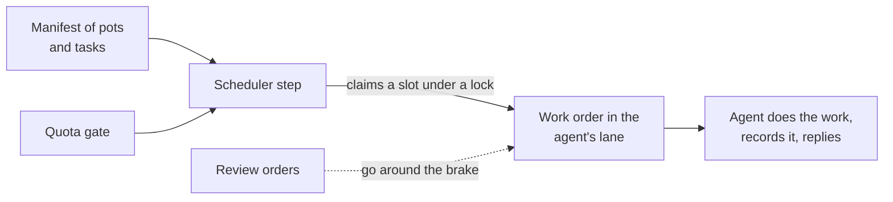

# Quota and tokens

Two different things are easy to confuse here. Quota is how much the agents may think and act, shared out of one subscription pot. Tokens, in the credential sense, are the secrets that let an agent use a service. They follow different rules.

## Contents

- [One pot](#one-pot)
- [Turning idle quota into work](#turning-idle-quota-into-work)
- [What we say about the pot in public](#what-we-say-about-the-pot-in-public)
- [Credentials](#credentials)

## One pot

The agents do not each have a budget. The fleet draws on one subscription pot with two windows, a short one measured in hours and a weekly one. One day the pot reached 100 percent and everything stopped, and nobody had seen it coming because no agent could read the meter. A small system grew out of that, built on three ideas.

1. A probe that measures for free. The terminal agent reports its own rate-limit figures to its status line, and a small tool collects them per seat into one fleet-wide view that every agent can read.
2. A gate that decides by kind of work. A heavy or recurring job asks the gate before it starts whether it may run now. The thresholds are stepped, and above the last one only the owner decides.
3. Sleeping is safe. Monitoring, backups and the patch chain run as shell jobs and cost no quota, so pausing the thinking never pauses the safety.

| Kind of work | Allowed up to about |
|---|---|
| Heavy | 60 percent of the pot |
| Normal | 80 percent |
| Essential | 92 percent |
| Anything above | the owner decides |

A second opinion exists for the case where the gate cannot read a fresh measurement, which happens at night for a headless job without a status line. It uses an idle proof: the reporting job is alive (a fresh report) while the last real measurement is old (the status line refreshes only on a turn). That pair means "asleep", which is different from "dead". Its own threshold is stricter than the gate's, about 40 percent against 60, because a headless job spends quota without refreshing the meter. It never overrules a "no" from the gate.

## Turning idle quota into work

A scheduler step called ergon decides, at zero agent tokens, whether a seat gets a work slot now. It reads a manifest of pots and tasks and asks the gate. It claims a slot under a lock so that two seats on the same pot cannot claim the same one, and it posts a work order into the lane of the claiming agent. The agent does the work, records it with a small tool and closes the order with a reply.

Four rules shape the slots.

- For the backlog task the mode alternates between the oldest open item and the highest-priority one. This is measured: a pure "highest priority first" rule can never reach old items that happen to be low priority, so a clean backlog would stay out of reach however hard the fleet worked.
- A slot may lapse with a reason. An order with nothing workable is closed as lapsed, never ignored.
- An unchanged blocker is skipped. An item that has been picked several times with exactly the same external blocker and no new progress is passed over, so that one stuck item does not consume every slot. If it shows real progress, it is a fresh candidate again. Skipping inside a slot is postponing and never burying, because a separate review-date sweep brings every item back.
- Reviews go around the brake. The owner's instruction was that review is the most important work, because a review blocks someone else. A review order is considered every round, at most once an hour per agent, whether or not the pot is under pressure.

## What we say about the pot in public

The pot is shared and finite, and the fleet treats it that way: it measures it, brakes before it is full, reserves the last stretch for the human, and writes down when a decision was a brake and not a choice. A percentage compared between two pots of different size says nothing, and the agents are told not to compare them.

## Credentials

The rules are short and strict.

| Rule | Reason |
|---|---|
| A secret lives in a vault and is read at runtime. Outside the vault it may exist only as a runtime file with restricted permissions, and it never travels on a message channel. | A channel is a place anyone can read. |
| A frozen credential is a dead agent. Secrets must be able to renew themselves. | The login tokens of the terminal agent have a short lifetime and a refresh token that renews them automatically, and monitoring tokens can be rotated. |
| Rotating a token means finding its readers first. | A push token has readers on other seats and on a copy of the monitoring configuration, and rotating without looking breaks guards silently. |
| Service accounts carry request limits. | The vault's request budget is shared per day by every account that reads it, so reads are budgeted and cached. |
| Each seat gets the narrowest credential that works. | Several jobs once had a vault token in their environment that nothing in them used. It was removed. |
| No credential moves between seats to make a task easier. | When a task needs a credential that lives on another seat, that seat performs the step and the first seat verifies the result. The publication of this repository was done that way. |
| A one-off login is not left behind. | A command-line tool that was logged in for one job is logged out afterwards, so that no token stays in a configuration file. |
