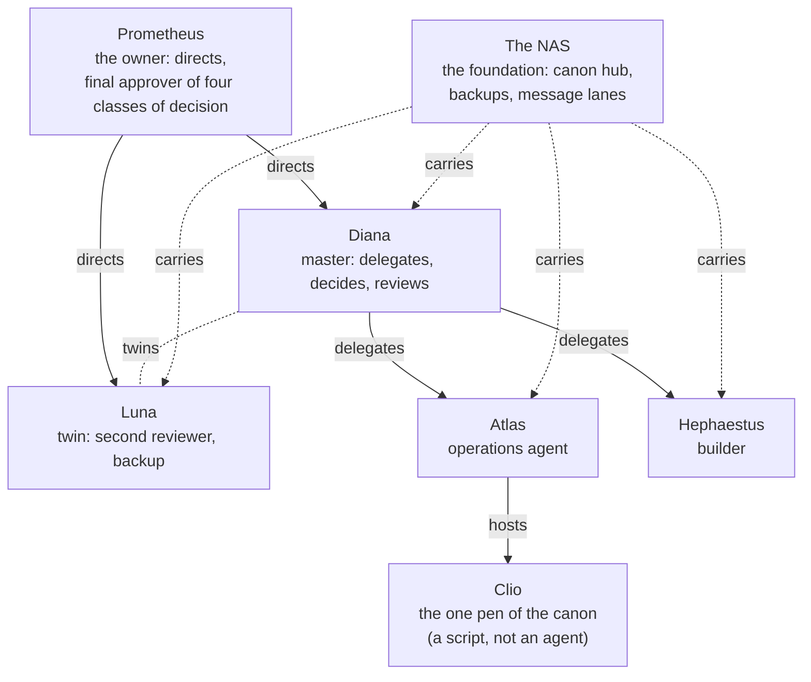

# The family

> **Note on this page.** Replaces the generated family page of the internal sites. The old page listed every internal address and service of the fleet; none of that is copied. What is kept is the shape of the family: who directs, who delegates to whom, who mirrors whom, and what carries what.

Olympus is a household and a team at the same time. The relations between its members are not all the same kind, and the page that drew them had a rule: **dashed lines are the two relations that are not delegation**: the twins, and what carries what.

## The members, in one line each

| Member | What it is |
|---|---|
| **Prometheus** | The human owner. Directs. |
| **Diana** | The master agent. Delegates, decides and reviews; first point of contact for the owner. |
| **Luna** | Diana's twin. Second pair of eyes, backup, and owner of the command filter. |
| **Atlas** | The operations agent: recurring jobs, monitoring, websites, updates. |
| **Hephaestus** | The builder: forges new tools and hands them over. |
| **Clio** | Not an agent. The single script that writes the shared canon. |
| **The NAS** | The foundation. The canon's hub, the backups, the message lanes. |

An independent checker on a different model family belongs to the design and is currently switched off.

## The coat of arms and the motto

The family has a coat of arms, designed by Luna and countersigned by the other three agents. Its motto is the house rule in two imperatives: **MEET, GOK NIET**: *measure, do not guess*. They are the owner's own words, and the fleet uses them as a test: a claim is either measured or it says that it is not.

## Where to read more

- [Agents](../docs/agents.md): the roles in detail and how decisions are sized.
- [Method](../docs/method.md): the canon, the tracker, the review rules and the laws.
- [The owner](the-owner.md): his own words and what the fleet thinks of him and of itself.
